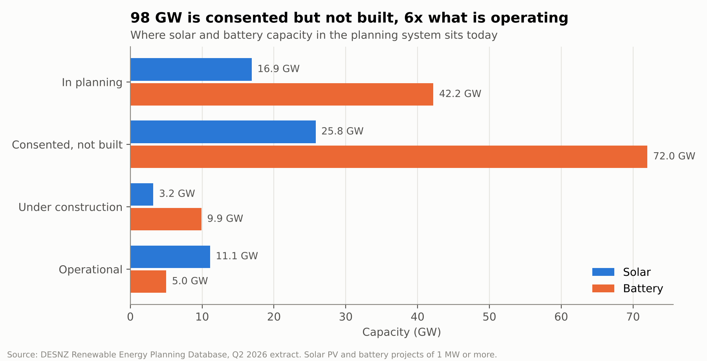
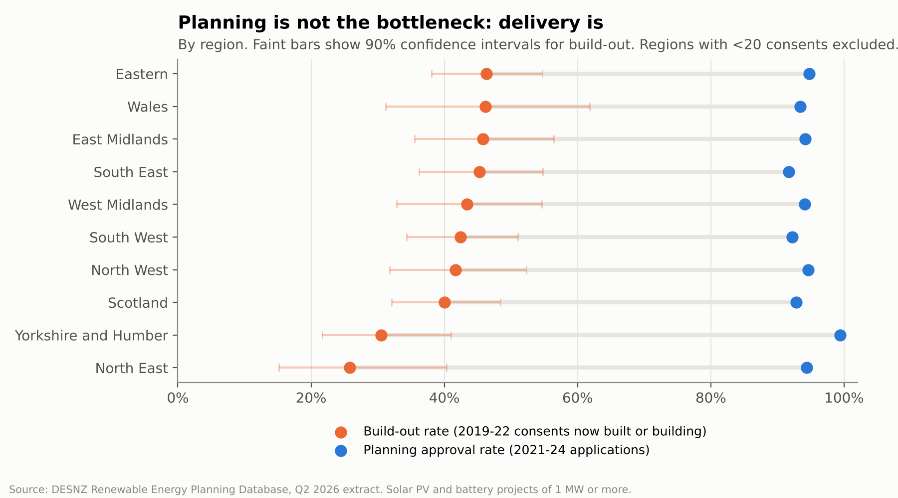
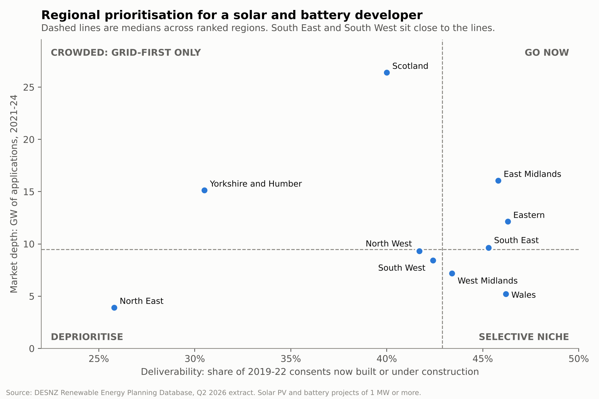

# Where is the UK's solar pipeline getting stuck?

A strategy case study using real government data. It answers a typical energy-sector client question:

> *A mid-size UK solar and battery developer wants to know which regions to prioritise over the next three years, and where its development budget is most at risk.*

**Short answer:** not in planning. 94% of decided applications are approved, but only 41% of projects consented in 2019-22 have reached construction. The constraint is delivery after consent, chiefly the grid connection. The developer should gate projects on grid access first, focus new solar in the Eastern region and East Midlands, and grow partly by acquiring stalled consented solar rather than originating standalone batteries.

Read the full **[one-page recommendation memo](docs/recommendation_memo.md)**.

## Key findings

| | |
|---|---|
| Capacity consented but not built | **98 GW**, six times the 16 GW operational |
| Planning approval rate (2021-24 applications) | **94%**, and every ranked region sits between 92% and 99% |
| 2019-22 consents now built or under construction | **41%** of 653 projects |
| Regional build-out range | **26%** (North East) to **46%** (Eastern) |
| Battery share of the consented, unbuilt backlog | **74%** |







More charts in [`outputs/figures`](outputs/figures): applications by year, the consent cohort outcomes, and a map of the operational and consented pipeline.

## Approach

1. **Scope.** Solar PV and battery storage projects of 1 MW or more in the REPD (Q2 2026 extract), onshore UK.
2. **Clean.** Standardise column names and text fields, parse capacities and dates, drop superseded ("Revised") records to avoid double counting, and flag impossible dates. Every step and its row count is logged in [`outputs/tables/00_cleaning_log.csv`](outputs/tables/00_cleaning_log.csv).
3. **Measure.** Group projects into pipeline stages, calculate approval rates (applications submitted 2021-24, so most have been decided), build-out rates (consents granted 2019-22, so each project has had at least three and a half years to start), and decision times.
4. **Prioritise.** Approval rates barely vary across regions, so they cannot separate them. The matrix instead compares deliverability (build-out rate) with market depth (GW applied for). Regions with fewer than 20 consents are excluded from the ranking, and 90% confidence intervals are shown so close calls are visible.
5. **Recommend.** Combine the findings with published context on the 2025 grid connections reform.

## Design decisions worth noting

- **1 MW floor.** The REPD lowered its inclusion threshold from 1 MW to 150 kW in 2021 (DESNZ, 2026). Without a floor, a jump in project counts after 2021 would partly reflect a recording change rather than real market growth.
- **Cohort windows.** Recent consents have not had time to be built, so including them would understate build-out. The 2019-22 window balances recency and fairness.
- **Honest uncertainty.** Differences between the top seven regions sit within sampling error. The memo says so rather than over-ranking them.

## Limitations

- REPD status fields come mainly from public sources and developers and can lag reality.
- A region is a coarse proxy for grid capacity. Substation-level headroom matters more.
- Northern Ireland and London have too few consents to rank. Northern Ireland is also excluded from the map because it uses a different grid reference system.

## Run it yourself

```bash
pip install -r requirements.txt
python run_analysis.py          # rebuilds every table in outputs/tables and chart in outputs/figures
```

Or open [`notebooks/analysis_walkthrough.ipynb`](notebooks/analysis_walkthrough.ipynb) for a step-by-step version with commentary.

## Repository structure

```
data/raw/                 REPD Q2 2026 extract (unchanged)
src/prepare.py            loading, cleaning and the cleaning log
src/analysis.py           one function per business question
src/charts.py             static charts
run_analysis.py           runs everything end to end
notebooks/                narrated walkthrough
outputs/tables/           every number quoted in the memo
outputs/figures/          charts
docs/recommendation_memo.md
```

## Sources

Department for Energy Security and Net Zero (DESNZ) (2026) *Renewable Energy Planning Database: quarterly extract, Q2 2026*. Available at: https://www.gov.uk/government/publications/renewable-energy-planning-database-quarterly-extract (Accessed: 15 October 2026).

Energy-Storage.news (2025) 'UK: "Painful but necessary" reforms see 153GW of battery storage projects cut from grid connection queue', 9 December. Available at: https://www.energy-storage.news/?p=91698 (Accessed: 15 October 2026).

Knight Frank (2025) *Connection reform update: a new pipeline announced*. 11 December. Available at: https://www.knightfrank.co.uk/research/article/2025/12/connection-reform-update-a-new-pipeline-announced (Accessed: 15 October 2026).

Contains public sector information licensed under the Open Government Licence v3.0.

---
*Author: Mehak Gupta, BSc Environmental and Data Science, King's College London.*
